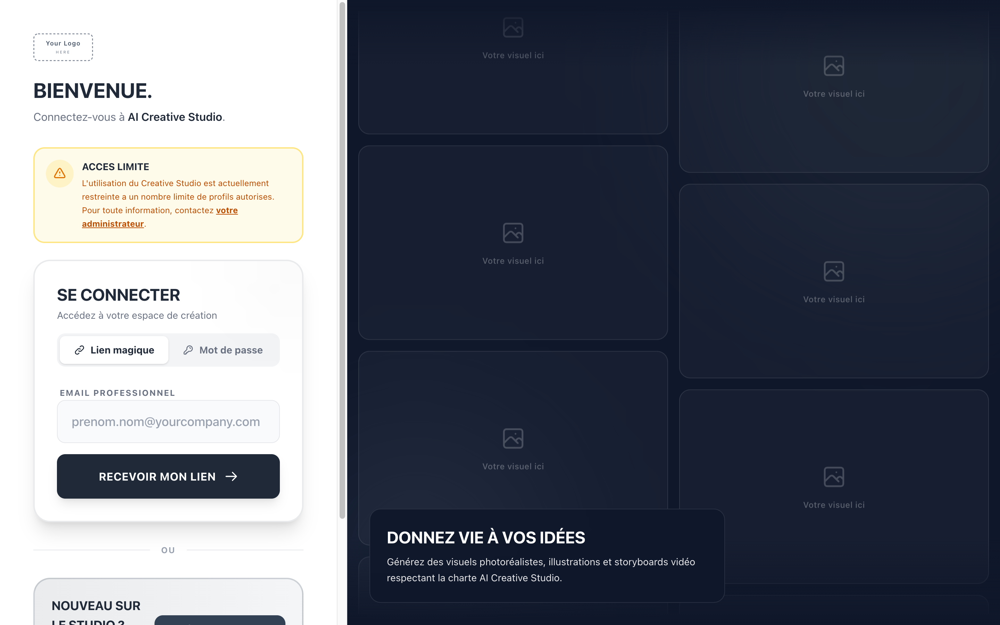
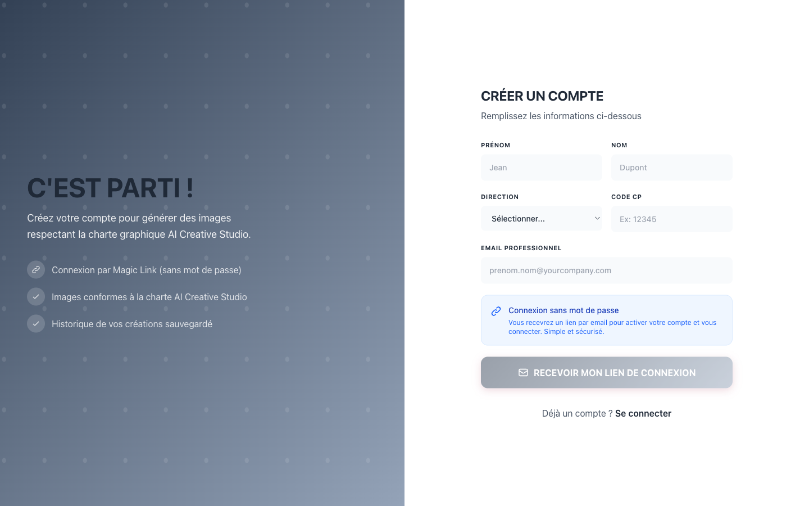

# AI Creative Studio

### A complete AI image & video studio — ready to rebrand and sell as your own.

Stop paying a team to rebuild what already exists. **Buy the source code, put your
logo on it, and launch in a weekend.**

---

## 🎬 What your customers get

A full, production-grade creative platform — not a demo:

- **AI image generation** — illustrations & iconography, formats 1:1 / 16:9 / 9:16 / 4:3, up to Ultra 4K.
- **AI video & short films** — storyboard-to-video and short-film pipelines across Veo 3.1, Kling and Seedance.
- **Storyboards** — multi-shot, with consistent style anchors and continuous audio.
- **Reference library** — steer generations with your own brand images.
- **Infinite whiteboard** — compose, annotate, arrange.
- **Projects & history** — every creation organised and re-runnable.
- **Accounts & admin** — Supabase auth, access requests, admin dashboards, per-user cost tracking.
- **Trademark-safe prompts** — built-in sanitization strips public figures and trademarks automatically.

## 🏷️ Built to be YOUR product

This ships **100% brand-neutral**. What you see below is the blank canvas — a
`Your Logo` placeholder, a calm grayscale palette, and tasteful grotesque type.
There is nothing to strip out: no prior owner's name, no leftover branding, no
hard-coded images, no third-party logos anywhere.

| Sign in | Create account |
|:---:|:---:|
|  |  |

> Notice the right-hand panels: **placeholder tiles**, not stock photos. The app
> never ships someone else's imagery — your customers plug in their own.

## ✨ What you can customize (in minutes, one file each)

- **Your logo** → drop it into one component (`BrandLogo`). It propagates everywhere.
- **Your colors** → change a single set of `--brand-*` design tokens. The whole UI recolors.
- **Your fonts** → swap two `.woff2` files. Done.
- **Your name** → one line in the layout + `package.json`.
- **Your reference library** → point it at your own hosted images.
- **Your email rules** → set which domains can sign up (or allow all).
- **Your providers** → Gemini, Kling, Seedance adapters included; add your keys.

No component surgery. No hunting through the codebase. The branding lives in a
handful of obvious places — by design.

## 💡 Why buy instead of build

- **Save months.** Auth, billing-ready cost tracking, video pipelines, storyboards, admin — already built and battle-tested in production.
- **Save money.** One purchase vs. a team of engineers for a quarter.
- **Own it.** You get the **full source code**. Self-host it, modify it, ship it under your brand.
- **Modern stack.** Next.js 16, TypeScript, Supabase, Docker/AWS — clean, typed, documented.
- **Launch fast.** Brand it today, deploy this week.

## 🧱 Tech stack

`Next.js 16 (App Router)` · `TypeScript` · `Tailwind CSS` · `Supabase` ·
`Gemini / Veo · Kling · Seedance` · `Docker · AWS (ECS/EC2)` · `GitHub Actions CI/CD`

## 🛒 Get the source code

The complete, private source lives at
**[`Connected-Mate/ai-creative-studio`](https://github.com/Connected-Mate/ai-creative-studio)**.
Full setup, environment and deployment docs are inside.

**Interested in a license?** Reach out — buy the code, save the time, ship your own studio.

---

© 2025–2026 · AI Creative Studio · All rights reserved.

